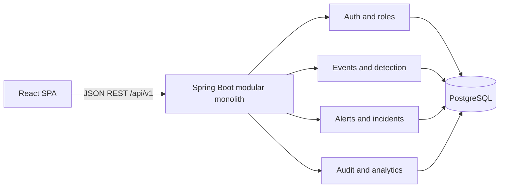

# SecureOps — Security Monitoring & Incident Response

SecureOps is a portfolio project that demonstrates a security operations workflow from event ingestion through detection, alert triage, incident tracking, and audit review. It runs with fictional data and is not a production SIEM.

## What it does

- Shows security activity, open alerts, incidents, and event volume in a live dashboard.
- Searches synthetic security events by description and category, with severity and category filters.
- Detects repeated failed logins followed by a successful login, plus privilege changes.
- Lets analysts update alert status, create investigation cases, and review audit history.
- Seeds a realistic demo workspace from a bundled dataset so the screens are populated on first run.

## Languages and tools

- **Languages:** Java, TypeScript, SQL, HTML, CSS, YAML
- **Backend:** Java 21, Spring Boot, Spring Security, Spring JDBC, Bean Validation, Flyway
- **Frontend:** React, TypeScript, Vite, Tailwind CSS, Recharts, React Router, TanStack Query
- **Data and delivery:** PostgreSQL, H2 for the quick preview, Docker Compose, GitHub Actions

The project demonstrates REST API design, role-based access control, CSRF protection, event search, rule-based detection, dashboard visualization, relational data modeling, synthetic data seeding, and containerized local setup.

## Stack

- Java 21, Spring Boot 3, Spring Security, Bean Validation, Spring JDBC
- PostgreSQL and Flyway
- React, TypeScript, Vite, Tailwind CSS, Recharts, React Router, TanStack Query, React Hook Form, Zod
- Docker Compose and GitHub Actions

## Quick start

The easiest option is Docker Compose. Install [Docker Desktop](https://www.docker.com/products/docker-desktop/) first.

```bash
git clone https://github.com/yassinechouyoukh/secureops.git
cd secureops
```

Copy the example environment file and set a local database password. In PowerShell, run `Copy-Item .env.example .env`; on macOS/Linux, run `cp .env.example .env`. Edit `.env` and replace `POSTGRES_PASSWORD=replace-this-local-password` with a password for this local demo. Then start the app:

```bash
docker compose up --build
```

Open [http://localhost:5173](http://localhost:5173) and sign in with `admin@secureops.local` / `ChangeMe123!`. Synthetic sample events, two detection alerts, an investigation case, and audit history are loaded automatically on the first start. Event search and the dashboard chart have data immediately.

Stop the app with `Ctrl+C`, then run `docker compose down` from the project folder. The PostgreSQL data volume is kept, so the sample data remains on the next start. To intentionally reset the local database and its sample data, run `docker compose down -v`.

### Run without Docker

This preview mode needs Java 21, Maven, Node.js 20+, and npm. It uses an in-memory H2 database and reloads the synthetic dataset each time the API starts.

In terminal 1, from the project folder:

```bash
cd backend
```

PowerShell: `$env:SPRING_PROFILES_ACTIVE="preview"; mvn spring-boot:run`

macOS/Linux: `SPRING_PROFILES_ACTIVE=preview mvn spring-boot:run`

In terminal 2, from the project folder:

```bash
cd frontend
npm ci
npm run dev
```

Open [http://localhost:5173](http://localhost:5173). API docs are at [http://localhost:8080/swagger-ui.html](http://localhost:8080/swagger-ui.html).

The `dev` and `preview` Spring profiles and their demo credentials are for local demonstrations only. Never use them in production. Production should keep `SERVER_SERVLET_SESSION_COOKIE_SECURE=true` and serve over HTTPS.

## Demo flow

The bundled dataset is `backend/src/main/resources/demo-events.tsv`. It contains fictional users, reserved example IP addresses, and synthetic activity spanning the last day. It is loaded once when a `dev` or `preview` database is empty. The demo includes failed login attempts followed by a successful login and privilege changes, so the rule engine creates sample alerts at startup. Use **Generate demo activity** to add another scenario, update alert statuses, create incidents, search the events, and review audit entries.

## Architecture



This first vertical slice is a Spring Boot modular monolith using parameterized `JdbcTemplate` queries and Flyway-managed PostgreSQL schema. The detection matching logic is separated into a small rule engine. Broader service/repository boundaries are a next step as event and case workflows grow.

## API overview

- `POST /api/v1/auth/login`, `POST /api/v1/auth/logout`, `GET /api/v1/auth/me`
- `GET /api/v1/dashboard`, `GET /api/v1/events`, `POST /api/v1/events`, `POST /api/v1/events/demo`
- `GET /api/v1/alerts`, `PATCH /api/v1/alerts/{id}`
- `GET /api/v1/incidents`, `POST /api/v1/incidents`, `GET /api/v1/audit`
- OpenAPI UI at `/swagger-ui.html`

## Environment

See `.env.example`. Database credentials must be supplied through environment variables outside the local `dev` profile. Never commit `.env`. Production mode disables demo seeding and requires HTTPS for secure session cookies.

## Security notes and limitations

Threats include credential guessing, forged or oversized event payloads, unauthorized analyst actions, SQL injection, session theft, and tampering with investigation records. Controls include BCrypt password hashing, server-side role checks, secure HttpOnly cookies (secure flag on outside local profiles), CSRF tokens, Bean Validation, parameterized JDBC, restricted CORS, server audit records, and a non-root API container. Dedicated login throttling and explicit JSON request-size limits are not implemented yet.

This demo uses synthetic identities and IPs only. Detection is rule-based, narrow, and not a substitute for a maintained SIEM, threat intelligence, or incident-response process. Demo credentials, a single organization, and local development settings are not production-safe. The current slice supports event search, alert status changes, basic incident creation, and audit review; alert notes/assignment, alert-to-incident linking/timelines, admin user management, event retention, MFA, and external identity are not implemented yet.

## Database

Tables: `app_user`, `security_event`, `alert`, `incident`, `incident_alert`, `audit_entry`. See `backend/src/main/resources/db/migration` for the authoritative schema.

## Tests

Backend: `cd backend; mvn test`. Frontend: `cd frontend; npm test -- --run`. CI builds both and runs the suites. Tests are only reported as passing after they have actually run.

## Roadmap

MFA and recovery, tenant isolation, richer detection windows, case evidence exports, retention policies, E2E browser tests, and deployment-specific secret management.
